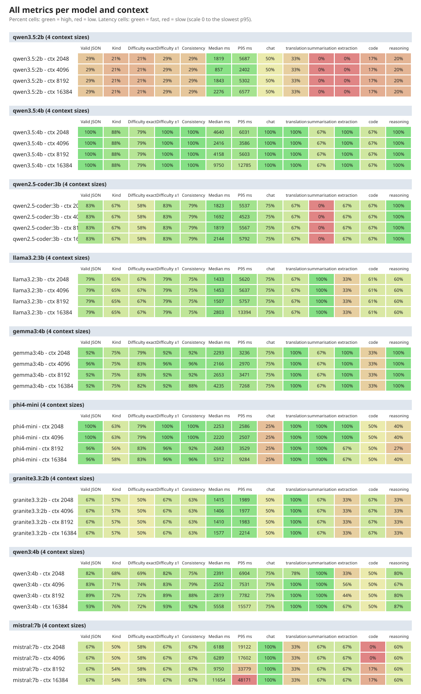
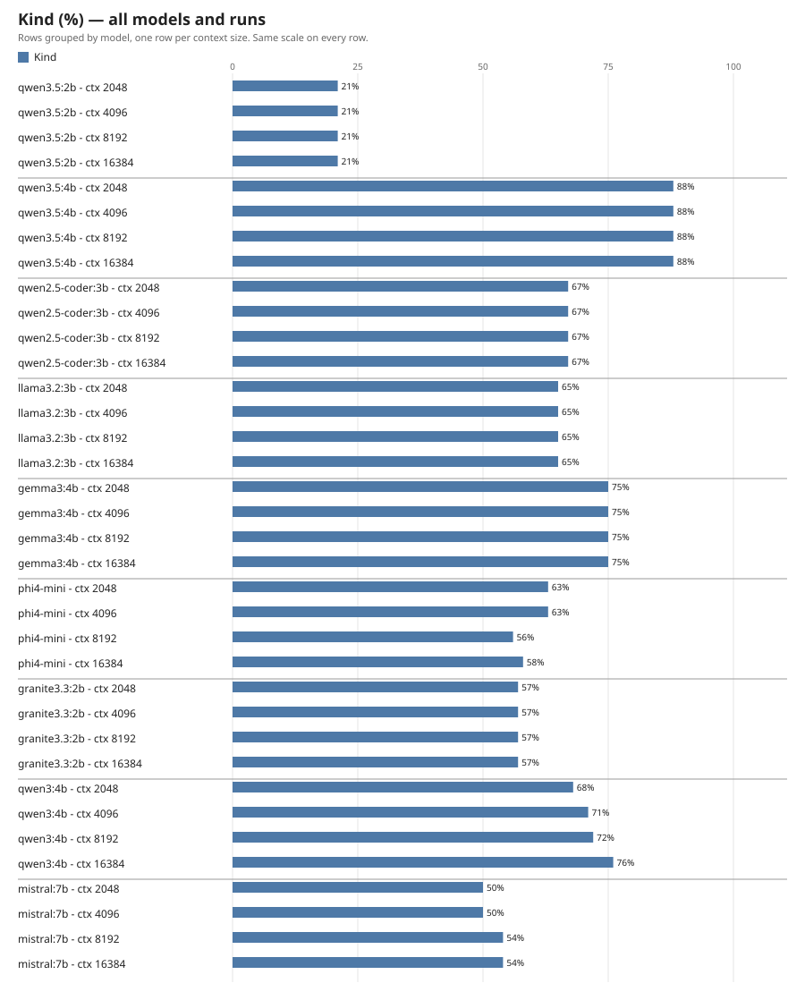
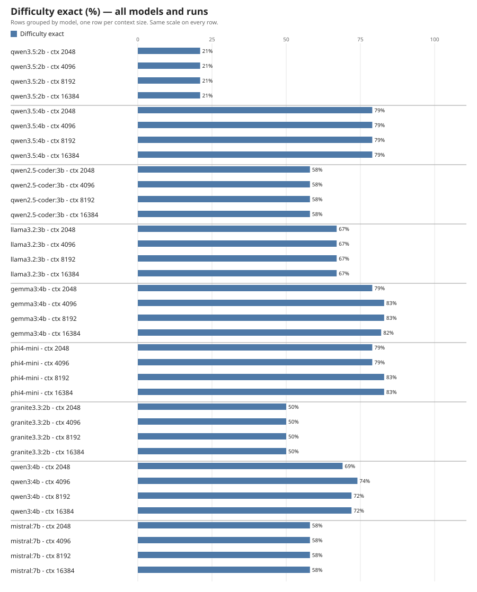
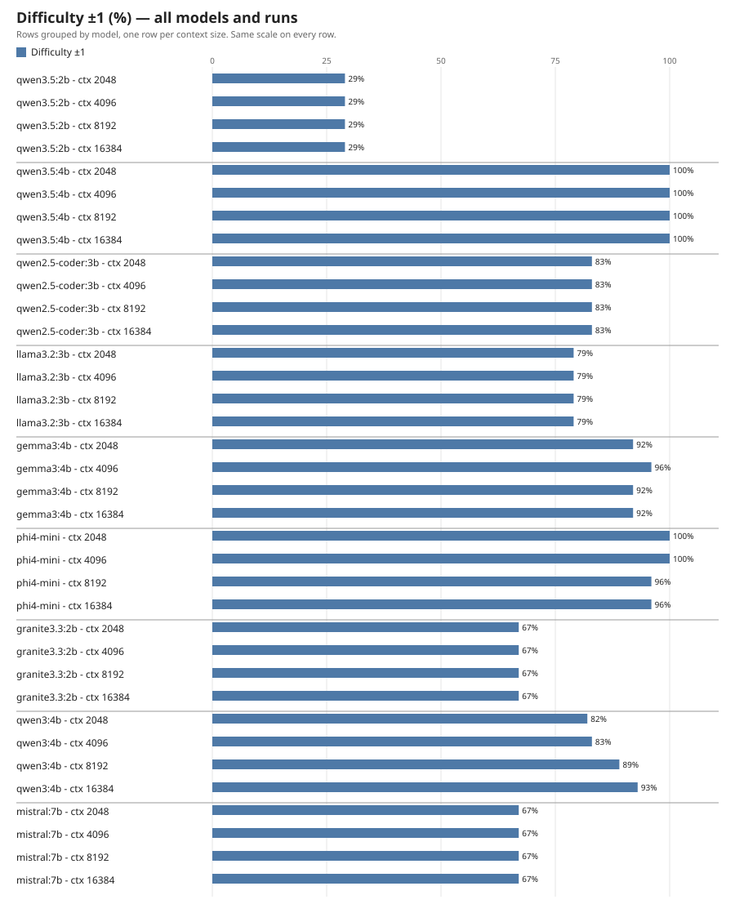
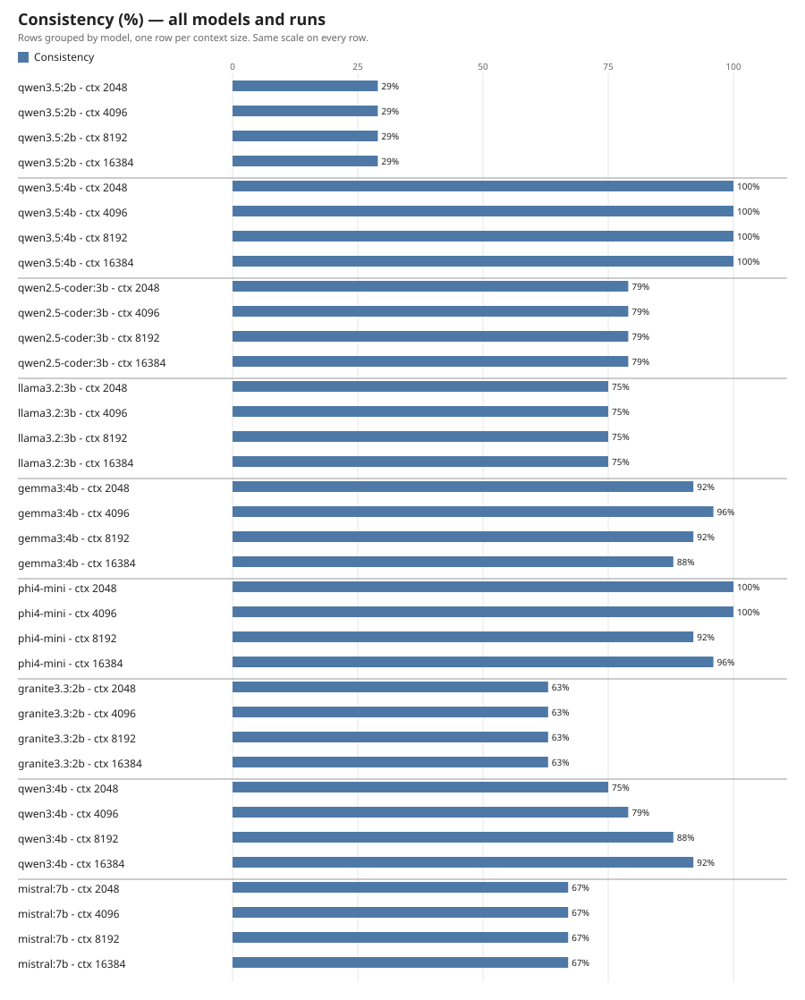
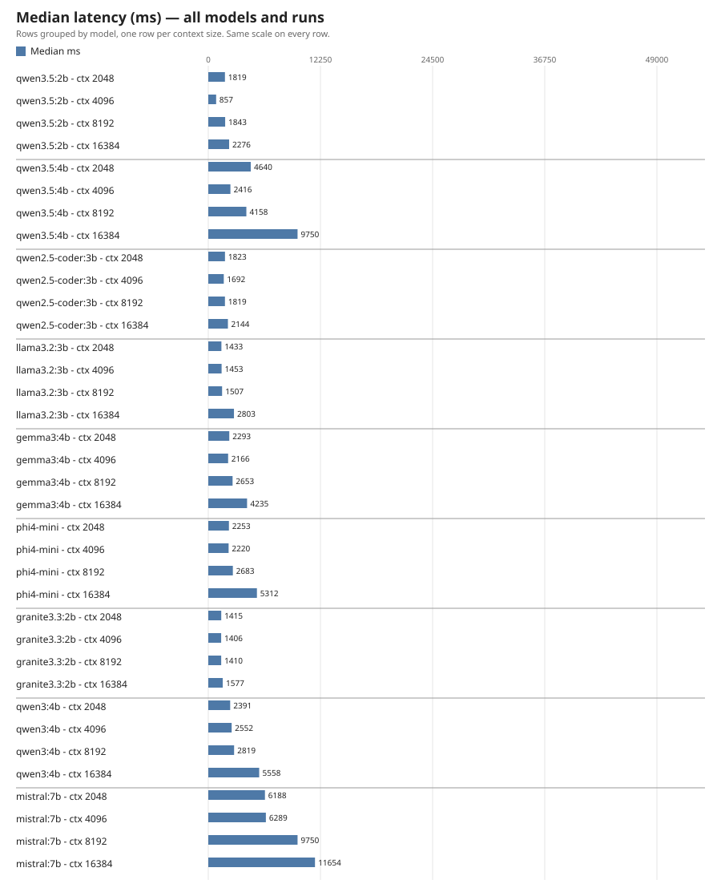
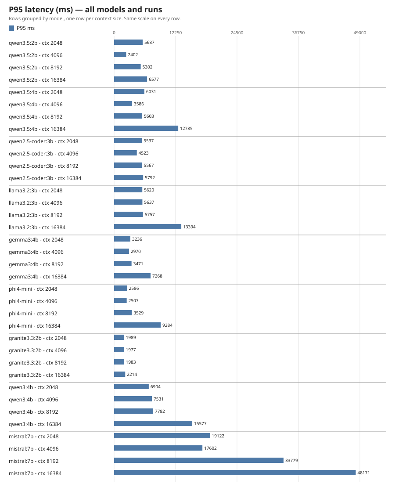
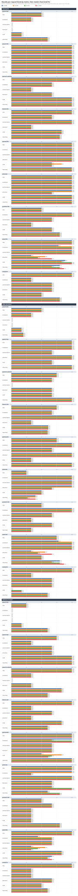

# Classifier evaluation — summary of all runs (2026-11-14)

Built from every `classifications-*.json` in this folder by `../build-classifier-summary.mjs`. 24 prompts × 3 repeats = 72 calls per model per run. Each chart shows every model run (model + test date) on one shared scale so models can be compared directly.

## All metrics per model and context

## Valid JSON (%) — all models and runs

## Kind (%) — all models and runs

## Difficulty exact (%) — all models and runs

## Difficulty ±1 (%) — all models and runs

## Consistency (%) — all models and runs

## Median latency (ms) — all models and runs

## P95 latency (ms) — all models and runs

## Results per request kind, all models and runs

## Numbers

| Model | Run (UTC) | num_ctx | Valid JSON | Kind | Diff exact | Diff ±1 | Consistency | Median ms | P95 ms |
|---|---|---:|---:|---:|---:|---:|---:|---:|---:|
| `qwen3.5:2b` | 2026-11-14T14-47-25-634Z | 2048 | 29% | 21% | 21% | 29% | 29% | 1819 | 5687 |
| `qwen3.5:2b` | 2026-11-14T12-08-57-478Z | 4096 | 29% | 21% | 21% | 29% | 29% | 857 | 2402 |
| `qwen3.5:2b` | 2026-11-14T12-45-12-377Z | 8192 | 29% | 21% | 21% | 29% | 29% | 1843 | 5302 |
| `qwen3.5:2b` | 2026-11-14T13-32-28-209Z | 16384 | 29% | 21% | 21% | 29% | 29% | 2276 | 6577 |
| `qwen3.5:4b` | 2026-11-14T14-47-25-634Z | 2048 | 100% | 88% | 79% | 100% | 100% | 4640 | 6031 |
| `qwen3.5:4b` | 2026-11-14T12-08-57-478Z | 4096 | 100% | 88% | 79% | 100% | 100% | 2416 | 3586 |
| `qwen3.5:4b` | 2026-11-14T12-45-12-377Z | 8192 | 100% | 88% | 79% | 100% | 100% | 4158 | 5603 |
| `qwen3.5:4b` | 2026-11-14T13-32-28-209Z | 16384 | 100% | 88% | 79% | 100% | 100% | 9750 | 12785 |
| `qwen2.5-coder:3b` | 2026-11-14T14-47-25-634Z | 2048 | 83% | 67% | 58% | 83% | 79% | 1823 | 5537 |
| `qwen2.5-coder:3b` | 2026-11-14T12-08-57-478Z | 4096 | 83% | 67% | 58% | 83% | 79% | 1692 | 4523 |
| `qwen2.5-coder:3b` | 2026-11-14T12-45-12-377Z | 8192 | 83% | 67% | 58% | 83% | 79% | 1819 | 5567 |
| `qwen2.5-coder:3b` | 2026-11-14T13-32-28-209Z | 16384 | 83% | 67% | 58% | 83% | 79% | 2144 | 5792 |
| `llama3.2:3b` | 2026-11-14T14-47-25-634Z | 2048 | 79% | 65% | 67% | 79% | 75% | 1433 | 5620 |
| `llama3.2:3b` | 2026-11-14T12-08-57-478Z | 4096 | 79% | 65% | 67% | 79% | 75% | 1453 | 5637 |
| `llama3.2:3b` | 2026-11-14T12-45-12-377Z | 8192 | 79% | 65% | 67% | 79% | 75% | 1507 | 5757 |
| `llama3.2:3b` | 2026-11-14T13-32-28-209Z | 16384 | 79% | 65% | 67% | 79% | 75% | 2803 | 13394 |
| `gemma3:4b` | 2026-11-14T14-47-25-634Z | 2048 | 92% | 75% | 79% | 92% | 92% | 2293 | 3236 |
| `gemma3:4b` | 2026-11-14T12-08-57-478Z | 4096 | 96% | 75% | 83% | 96% | 96% | 2166 | 2970 |
| `gemma3:4b` | 2026-11-14T12-45-12-377Z | 8192 | 92% | 75% | 83% | 92% | 92% | 2653 | 3471 |
| `gemma3:4b` | 2026-11-14T13-32-28-209Z | 16384 | 92% | 75% | 82% | 92% | 88% | 4235 | 7268 |
| `phi4-mini` | 2026-11-14T14-47-25-634Z | 2048 | 100% | 63% | 79% | 100% | 100% | 2253 | 2586 |
| `phi4-mini` | 2026-11-14T12-08-57-478Z | 4096 | 100% | 63% | 79% | 100% | 100% | 2220 | 2507 |
| `phi4-mini` | 2026-11-14T12-45-12-377Z | 8192 | 96% | 56% | 83% | 96% | 92% | 2683 | 3529 |
| `phi4-mini` | 2026-11-14T13-32-28-209Z | 16384 | 96% | 58% | 83% | 96% | 96% | 5312 | 9284 |
| `granite3.3:2b` | 2026-11-14T14-47-25-634Z | 2048 | 67% | 57% | 50% | 67% | 63% | 1415 | 1989 |
| `granite3.3:2b` | 2026-11-14T12-08-57-478Z | 4096 | 67% | 57% | 50% | 67% | 63% | 1406 | 1977 |
| `granite3.3:2b` | 2026-11-14T12-45-12-377Z | 8192 | 67% | 57% | 50% | 67% | 63% | 1410 | 1983 |
| `granite3.3:2b` | 2026-11-14T13-32-28-209Z | 16384 | 67% | 57% | 50% | 67% | 63% | 1577 | 2214 |
| `qwen3:4b` | 2026-11-14T14-47-25-634Z | 2048 | 82% | 68% | 69% | 82% | 75% | 2391 | 6904 |
| `qwen3:4b` | 2026-11-14T12-08-57-478Z | 4096 | 83% | 71% | 74% | 83% | 79% | 2552 | 7531 |
| `qwen3:4b` | 2026-11-14T12-45-12-377Z | 8192 | 89% | 72% | 72% | 89% | 88% | 2819 | 7782 |
| `qwen3:4b` | 2026-11-14T13-32-28-209Z | 16384 | 93% | 76% | 72% | 93% | 92% | 5558 | 15577 |
| `mistral:7b` | 2026-11-14T14-47-25-634Z | 2048 | 67% | 50% | 58% | 67% | 67% | 6188 | 19122 |
| `mistral:7b` | 2026-11-14T12-08-57-478Z | 4096 | 67% | 50% | 58% | 67% | 67% | 6289 | 17602 |
| `mistral:7b` | 2026-11-14T12-45-12-377Z | 8192 | 67% | 54% | 58% | 67% | 67% | 9750 | 33779 |
| `mistral:7b` | 2026-11-14T13-32-28-209Z | 16384 | 67% | 54% | 58% | 67% | 67% | 11654 | 48171 |

## Models with no results in any JSON yet

These models are configured but have no `classifications-*.json` entry, so they are not in the charts above. A model can already have preliminary numbers in a run report (`classifications-<date>.md`) before its JSON entry exists.

- none

## Rules of reporting

Rules the project owner gave for these reports:

- The results folder is called `classifier-evaluation-results`.
- JSON files are named `classifications-<test start>.json` and contain a top-level `"tested"` field with the test start date and time.
- Report files are named `classifications-<date>.md`; the date, filename and contents must agree with the run's `tested` date.
- Every report names its source JSON in a `Source:` line.
- Run all configured models, including the ones already pulled, starting with the ones not yet pulled.
- Update the results, the report and the charts as each model's results come in, and report progress while tests are running.
- Do not delete files without explicit confirmation.
