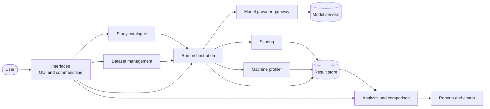

# GS-ModelBench — functional architecture

This folder describes **what** GS-ModelBench does: its concepts, components, rules and workflows.
It names no technology. Languages, frameworks, storage formats and model servers are covered in
[`../planning/`](../planning/).

## Purpose

GS-ModelBench answers one question: **which model should I use for this task, on this machine?**
It runs a set of labelled cases against one or more models. It scores each answer against the
expected label and measures speed. It keeps every result so runs can be compared over time,
across settings and across machines.

## Documents

| Document | Content |
|---|---|
| [domain-model.md](domain-model.md) | The concepts and how they relate: study, dataset, case, model, run, call, score. |
| [components.md](components.md) | The functional building blocks and what each is responsible for. |
| [workflows.md](workflows.md) | What a user does, step by step: author a study, run it, compare results. |
| [scoring-and-metrics.md](scoring-and-metrics.md) | How answers are scored and how metrics are aggregated. |
| [rules.md](rules.md) | Rules that keep results trustworthy and comparable. |

## Principles

1. **Task first.** A study tests one concrete task. General intelligence is out of scope.
2. **Quality and speed together.** Every run reports both, side by side, per model.
3. **Separate skills, separate metrics.** Following the output format, being right, being
   consistent and being fast are reported separately. No single score hides a weakness.
4. **Results are permanent.** Results are never overwritten or changed. A new run adds a new
   record. A run is removed only when the user explicitly confirms its deletion.
5. **Reproducible by construction.** Each run stores everything needed to repeat it: the study
   version, the dataset version, the settings and the machine.
6. **Comparable only when like-for-like.** The system shows when two runs can't be compared
   fairly, for example because the dataset changed.
7. **Generic core, task-specific scoring.** Running, storing and comparing work the same for every
   study. Only the output format and the scoring differ per task type.
8. **Same functions, any interface.** Everything the GUI can do, the command line can also do.

## Overview

