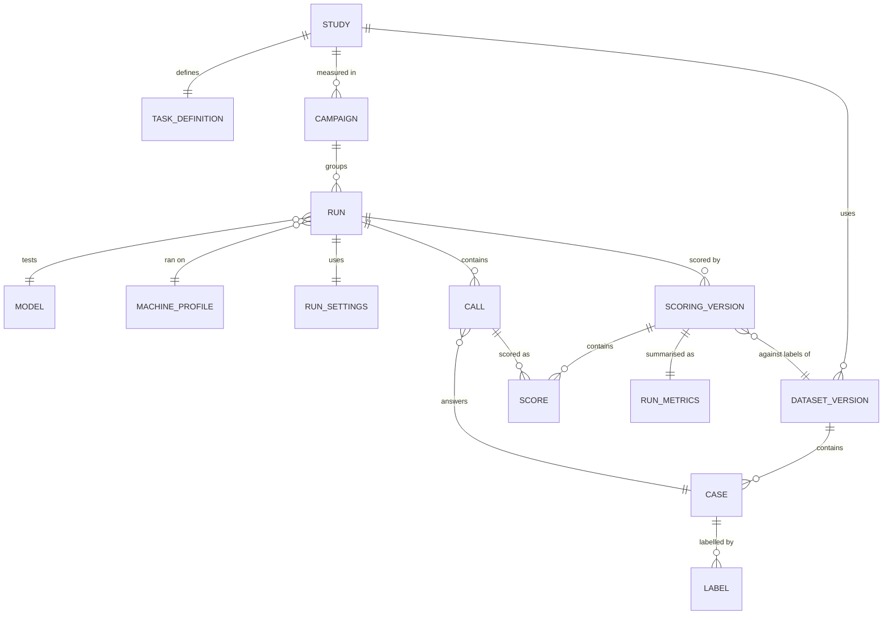

# Domain model

The concepts GS-ModelBench works with and how they relate.

## Concepts

### Study
A named investigation of one task, for example *"Classify a chat request by kind and difficulty"*.
It holds the task definition, the dataset, default settings and the models of interest. A study
has a version. Changing its task definition creates a new version.

### Task definition
What the model is asked to do, and what counts as a valid answer.
- **Instruction:** the fixed instruction given to the model for every case.
- **Output schema:** the fields the answer must contain and the values each may take. For the
  classifier: `kind` (one of six values) and `difficulty` (one of three ordered levels).
- **Tolerance:** for each ordered field, the number of steps N an answer may be off and still
  count as within-N accurate. For the classifier's `difficulty`: N = 1.
- **Task type:** selects the scoring method, for example classification, extraction or free text.
  See [scoring-and-metrics.md](scoring-and-metrics.md).

### Dataset and dataset version
The cases a study runs. A dataset is versioned: any change to a case, its text or its label
creates a new version. Each version has a fingerprint, so a run can prove which cases it used.

### Case
One input with its expected answer.
- **Id:** stable and unique within the dataset.
- **Input:** the text sent to the model.
- **Reference label:** the one expected answer that models are scored against.
- **Tags:** used to group results, for example `ambiguous`, `real-traffic` or `synthetic`.
- **Source:** written by hand, or imported from real use.

### Label
An answer given by one labeller. A case can have labels from several labellers.
- The **reference label** is the primary labeller's label. When labellers disagree, the user
  either confirms the reference label or tags the case `ambiguous`.
- The other labels are never used to score models. They are used only to measure how often
  labellers agree, which shows how clear the case is and sets the realistic ceiling for model
  accuracy.

### Model
A model under test, identified by name and exact variant (size, quantisation). The model is
recorded as reported by the server at run time, not just as configured.

### Run settings
The generation and execution settings for one run: temperature, output cap, context size,
reasoning on or off, structured output on or off, repeats per case, time limit per call, and
whether a warm-up call is made first.

### Machine profile
The hardware and software a run used: processor, memory, graphics card and its memory, the
model server and its version, and how the model was split between graphics card and processor.
Taken at the start and the end of a run.

It also holds a **disturbance flag**. The profiler sets it automatically when it detects
conditions that distort speed, such as heavy load from other work or a hot graphics card at the
start. The user can also set or clear it by hand, with a note.

### Campaign
A set of runs meant to be compared, sharing one study version and one dataset version. The
models and the run settings may differ between runs in a campaign. Those are what it compares,
for example several models, or one model at several context sizes. Runs from different campaigns
are compared only with a warning (see [rules.md](rules.md)).

### Run
One model, with one set of settings, over one dataset version, on one machine, at one time. A run
has a status: `planned`, `running`, `paused`, `completed`, `cancelled` or `failed`. A run that
stops early keeps the results it already has.

A run records its **origin**:
- **local:** run on this installation, with who started it
- **imported:** shared from another installation, with the source and the import date
- **migrated:** converted from an older result format, possibly with fields missing

### Call
One request to the model for one case and one repeat. It records:
- the exact text sent and the **raw text received**
- the parsed answer, or why parsing failed
- the elapsed time, plus time to first token and token counts when the server reports them
- any error, such as a timeout or a server error

### Scoring version
One complete scoring of a run's calls against the reference labels of one dataset version. A run
gets its first scoring version when it runs. Re-scoring adds a new one and never replaces an
existing one.
- A run can be re-scored against a later dataset version only for cases whose input text is
  unchanged. Cases whose input changed, or that were removed, are left out of that scoring
  version and listed as excluded.
- The run stays in its original campaign. The campaign shows which scoring version each run is
  displayed with. By default that is the latest scoring version against the campaign's dataset
  version or a later one.

### Score
The result of comparing a call's answer with the case's reference label, within one scoring
version. Each field is scored separately, so a classification call has a kind score and a
difficulty score.

### Run metrics
The aggregated results of one scoring version: format validity, accuracy per field, consistency
and latency. They are given overall and broken down by tag, label value and difficulty. Each
metric comes with an uncertainty range.
