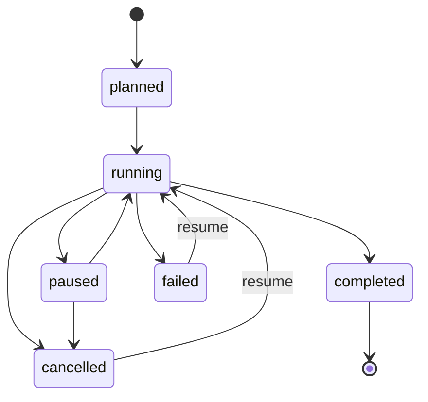

# Workflows

The main things a user does, step by step. The **Uses** column names the component from
[components.md](components.md) that carries out each step.

## 1. Create a study

| # | Step | Uses |
|---|---|---|
| 1 | Name the study and describe the task in one sentence. | `Study catalogue` |
| 2 | Choose the task type, for example classification. | `Study catalogue` |
| 3 | Write the instruction the model receives. | `Study catalogue` |
| 4 | Define the output schema: the fields, the allowed values for each, and the tolerance N for ordered fields. | `Study catalogue` |
| 5 | Set the default run settings and the models of interest. | `Study catalogue`, `Model provider gateway` |
| 6 | Set the coverage targets, for example a minimum number of cases per label value. | `Dataset management` |

## 2. Build the dataset

| # | Step | Uses |
|---|---|---|
| 1 | Add cases by hand, or import them, including inputs from records of real use. | `Dataset management` |
| 2 | Label each case. The primary labeller's label becomes the reference label. Optionally a second labeller labels the cases without seeing the first labels. | `Dataset management` |
| 3 | Review the coverage check. Fill gaps until every group meets its target. | `Dataset management` |
| 4 | Review cases where labellers disagree. Confirm or fix the reference label, tag the case as ambiguous, or remove it. | `Dataset management` |
| 5 | Freeze the dataset as a version. | `Dataset management`, `Result store` |

## 3. Plan and start a campaign

| # | Step | Uses |
|---|---|---|
| 1 | Pick a study version and a dataset version. | `Study catalogue`, `Dataset management` |
| 2 | Pick the models and, optionally, the settings to vary, for example context sizes. | `Run orchestration`, `Model provider gateway` |
| 3 | Review the plan: number of runs, number of calls and estimated duration. | `Run orchestration` |
| 4 | Start the campaign. Runs are queued with status `planned` and run one at a time. | `Run orchestration`, `Model provider gateway`, `Machine profiler` |

## 4. Watch a run

| # | Step | Uses |
|---|---|---|
| 1 | See live progress: current model, current case, calls done and time left. | `Run orchestration` |
| 2 | See metrics update as calls complete. | `Scoring`, `Result store` |
| 3 | Pause, resume or cancel. Results gathered so far are kept. | `Run orchestration`, `Result store` |
| 4 | Set or clear the disturbance flag, with a note, if speed was affected. | `Machine profiler` |

## 5. Analyse and compare

| # | Step | Uses |
|---|---|---|
| 1 | Open a campaign and see every model's metrics, with uncertainty ranges. | `Analysis and comparison` |
| 2 | Plot accuracy against latency to see the trade-off. | `Analysis and comparison` |
| 3 | Break results down per label value, difficulty and tag. | `Analysis and comparison` |
| 4 | Drill into a weak spot, down to individual calls and raw answers. | `Analysis and comparison`, `Result store` |
| 5 | Compare with runs from other campaigns, settings or machines, with warnings where runs are not like-for-like. | `Analysis and comparison` |

## 6. Correct and re-score

| # | Step | Uses |
|---|---|---|
| 1 | While analysing, find a case whose label is wrong. | `Analysis and comparison` |
| 2 | Correct the reference label. This creates a new dataset version. | `Dataset management` |
| 3 | Re-score existing runs against the new version without calling the models again. Cases whose input changed are excluded. | `Scoring` |
| 4 | The runs stay in their campaigns and are shown with the new scoring version. The old scoring versions stay available. | `Result store`, `Analysis and comparison` |

## 7. Report and share

| # | Step | Uses |
|---|---|---|
| 1 | Generate a report for a campaign or a selection of runs. | `Reporting` |
| 2 | Add a written conclusion. | `Reporting` |
| 3 | Export runs to share with others. Import runs others made on their own machines. | `Result store` |
