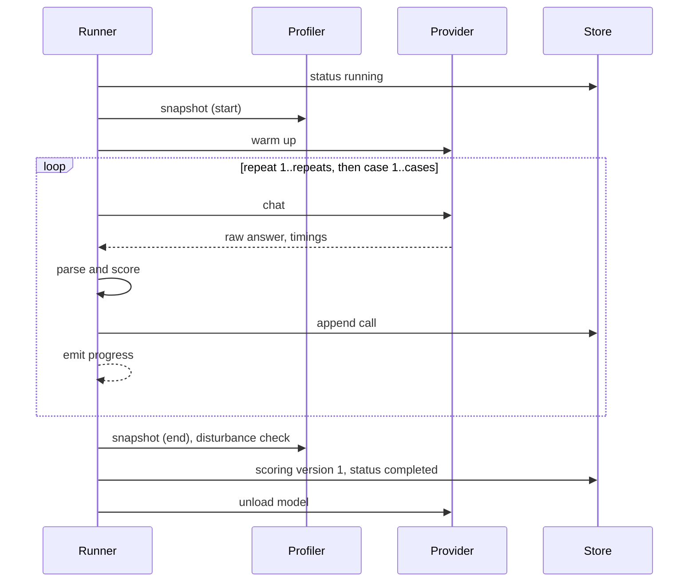

# Run execution

How `packages/runner` plans, executes and scores runs.

## Planning

1. Input: study, dataset version, models, and settings values to vary. Each setting can take
   several values, for example context sizes `[2048, 4096]`.
2. Expand into runs: models × combinations of varied settings.
3. Calls per run: cases × repeats.
4. Estimated duration per run: the median `totalMs` of the latest completed run with the same
   provider, model, context size and machine, times the number of calls, plus 30 s for loading.
   Without history: 3 s per call. The estimate is shown as an estimate.
5. The plan is shown before anything starts. Nothing is written until it is confirmed.

## Queue

- One queue per server process, in memory, backed by run statuses on disk.
- Runs are executed one at a time, in the order they were queued.
- On start-up, the runner rebuilds the queue from runs with status `planned`. Runs found as
  `running` were interrupted by a crash or shutdown. They are set to `paused` with the note
  `interrupted`, and the user resumes them.

## Executing a run

- **Order:** all cases in repeat 1, then all cases in repeat 2, and so on. A run stopped early
  then has every case at least once.
- **Warm-up:** one call with the first case's input. Not stored as a call and not counted.
- **Pause and cancel** take effect between calls. The call in progress finishes and is stored.
- **Resume** continues from the next call after the last one stored.
- **Load sampling:** every 60 s while the run is active, stored in `run.json`.
- **Unload** after each run, so the next model starts on a free graphics card.

## Failure

- A call that times out or gets a server error is stored with state `error`, and the run goes on.
- After 5 calls in a row with state `error`, the run is set to `failed`. Resuming it retries from
  the first failed call of that streak and replaces nothing. The failed calls stay in the file,
  and new attempts are added with the same `caseId` and `repeat`. Scoring uses the latest attempt.
- If the model isn't available on the provider at start, the run fails at once, before any call.

## Scoring

- Each call is parsed and scored as it arrives, so progress shows live metrics.
- When the run completes, `scores-1.json` is written against the campaign's dataset version.
- **Re-scoring** against dataset version `N`:
  1. `rescoreEligibility(campaignDataset, datasetN)` gives the kept and excluded cases.
     A case is kept if its `id` and `input` are unchanged.
  2. Kept calls are scored against the new reference labels.
  3. A new `scores-<next>.json` is written, and `displayScoringVersion` in `run.json` is set to it.
  4. Re-scoring never calls a model.

## Disturbance detection

The profiler flags a run when any of these hold. Thresholds are configurable:

| Check | When | Default threshold |
|---|---|---|
| Graphics card temperature | Before the warm-up | ≥ 80 °C |
| Graphics card already busy | Before the warm-up | utilisation ≥ 20% |
| Processor load from other work | Any 60 s sample | 1-minute load average ≥ 50% of cores, excluding the model server process |
| Model only partly on the graphics card | Placement changes during the run | any change |

The flag records which check fired. The user can clear it or set it by hand, with a note.

## Events

The runner emits these. The server forwards them as Server-Sent Events.

| Event | Payload |
|---|---|
| `queue.changed` | Run ids in queue order. |
| `run.status` | Run id, new status, note. |
| `run.progress` | Run id, calls done, calls total, estimated time left, live metrics. |
| `run.call` | Run id, sequence number, case id, state, total ms. |
| `run.disturbance` | Run id, check that fired. |
