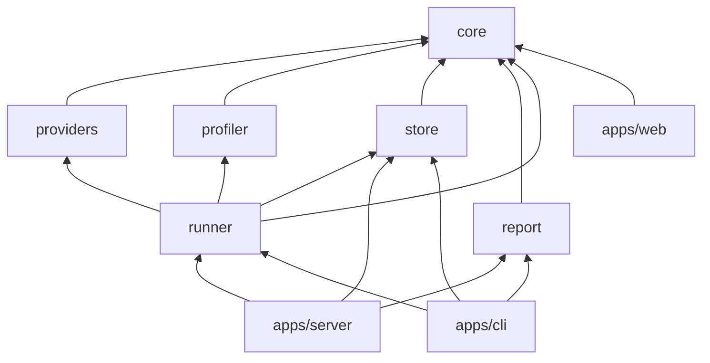

# Technology

## Stack

| Area | Choice | Why |
|---|---|---|
| Licence | Apache License 2.0 | Already in [`LICENSE`](../../LICENSE). Permissive, with a patent grant. |
| Language | TypeScript, strict mode, everywhere | One language for GUI, server, command line and core. |
| Runtime | Node.js 22 LTS | Continues the existing scripts. |
| Module format | ES modules only | Native in Node.js 22 and Angular. |
| GUI | Angular 22: standalone components, signals, zoneless change detection | Project goal. |
| GUI components | Angular Material | Maintained by the Angular team, accessible, light and dark themes. |
| Charts | Apache ECharts via `ngx-echarts` | Scatter, bar and heatmap (confusion matrix), with click-through for drill-down. |
| Server | Fastify | Small, fast, schema-validated routes, good TypeScript support. |
| Validation | Zod | One schema per domain concept, shared by GUI, server, CLI and files. |
| Fastify and Zod | `fastify-type-provider-zod` | Route types and validation from the same Zod schemas. |
| Live progress | Server-Sent Events | Progress flows one way. Built into browsers as `EventSource`. |
| Result store | JSON and JSON Lines files on disk | Readable without the app, easy to share and review in git. |
| Command line | `commander` | Widely used, small, typed. |
| First model server | Ollama | Used by the existing study. |
| Second model server | OpenAI-compatible endpoints | One adapter covers llama.cpp server, vLLM and LM Studio. |
| Package management | npm workspaces | Built into Node.js, no extra tool. |
| TypeScript builds | `tsc` project references for packages, Angular CLI for the GUI | No extra bundler for Node.js code. |
| Unit and integration tests | Vitest | Fast, ES-module native. Angular's default test runner. |
| End-to-end tests | Playwright | GUI against the real server and a stub model server. |
| Lint and format | ESLint (typescript-eslint, angular-eslint) and Prettier | Standard for TypeScript and Angular. |
| CI | GitHub Actions | The repo is on GitHub. |

Versions are pinned in `package-lock.json`. Dependencies are updated by Dependabot, weekly, in
grouped pull requests.

## Repository layout

```text
apps/
  web/              Angular GUI
  server/           Fastify API, event stream, serves the built GUI
  cli/              command line, binary name `modelbench`
packages/
  core/             domain schemas, parsing, scoring, metrics, uncertainty, coverage, comparability
  providers/        model provider gateway: Ollama, OpenAI-compatible
  profiler/         machine profiler and disturbance detection
  store/            result store on files, locking, import, export, migration
  runner/           run planning, queue, execution, pause, resume, cancel
  report/           Markdown reports and SVG charts
  testing/          stub model server and test fixtures, used by tests only
studies/
  classifier-evaluation/   the existing study, in the new format
dev/
  architecture/     what the system does
  planning/         how it is built
legacy/
  classifier-evaluation/   the original scripts, until milestone M6 removes them
```

## Dependency rules



- `packages/core` depends on nothing but Zod. It uses no Node.js-only APIs, so the GUI can use it
  too.
- `apps/web` imports only `packages/core`. Everything else it reaches through the server API.
- Packages never import apps. Apps never import each other.
- An ESLint rule (`import/no-restricted-paths`) enforces these rules in CI.
